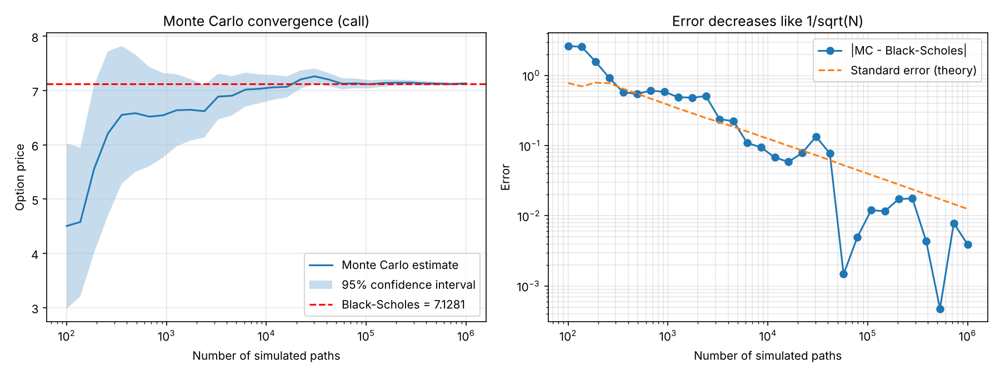

# European Option Pricing: Black-Scholes vs Monte Carlo

Pricing a European call and put option in two ways, and checking that they agree:

1. **Black-Scholes closed-form formula**
2. **Monte Carlo simulation** of the stock price under the risk-neutral measure

## Model

The stock follows a geometric Brownian motion:

dS_t = r S_t dt + σ S_t dW_t

so at maturity T, S_T = S_0 · exp((r − σ²/2)·T + σ·√T·Z) with Z ~ N(0, 1).
The option price is the discounted expected payoff: price = e^(−rT) · E[payoff(S_T)].

## Results

With S_0 = 100, K = 105, T = 1, r = 3%, σ = 20% and 1,000,000 paths:

| Option | Black-Scholes | Monte Carlo (95% CI) |
|--------|---------------|----------------------|
| Call   | 7.1281        | 7.1320 ± 0.0246      |
| Put    | 9.0248        | 9.0250 ± 0.0217      |

Put-call parity (C − P = S_0 − K·e^(−rT)) is also verified numerically.



The Monte Carlo error decreases like 1/√N, as predicted by the Central Limit Theorem.

## Run it

```bash
pip install numpy matplotlib
python pricing.py
```

## Possible extensions

- Variance reduction (antithetic variates, control variates)
- Greeks (delta, vega) by finite differences or pathwise estimators
- Path-dependent options (Asian, barrier)
- Implied volatility solver

## Notes

Code written with the help of an AI assistant (Claude); I went through each part of it to understand the model, the estimator and the convergence behaviour.
